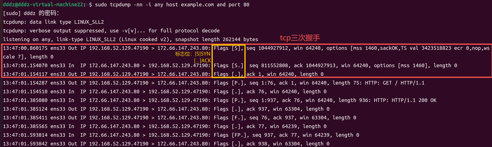

# TCP 基础与三次握手

## 一、本次学习目标

- 区分 TCP 和 UDP 解决的问题；
- 理解 IP、端口、socket 和 TCP 连接的关系；
- 能按顺序复述 TCP 三次握手；
- 会用 `ss` 观察监听和连接状态。

本次只学习 TCP 的基本定位和连接建立，不深入序列号重传、滑动窗口、拥塞控制、四次挥手和 `TIME_WAIT`。

## 二、TCP 解决什么问题

TCP 为两个程序提供**可靠、有序的字节流通信**。它主要处理：

- 数据尽量可靠到达；
- 数据按发送顺序交给应用程序；
- 发现丢失后进行重传；
- 通过连接状态管理双方通信。

TCP 不理解 HTTP 请求，也不知道业务数据的含义。TCP 只负责传输字节，HTTP 负责规定这些字节如何表示请求和响应。

## 三、TCP 和 UDP 的区别

| 对比项 | TCP | UDP |
| --- | --- | --- |
| 是否建立连接 | 需要连接 | 不需要连接 |
| 是否保证到达 | 提供可靠传输机制 | 不保证 |
| 是否保证顺序 | 保证按序交付 | 不保证 |
| 数据形式 | 字节流 | 数据报 |
| 流量控制、拥塞控制 | 有 | 没有 |
| 首部长度 | 至少 20 字节，可带选项 | 固定 8 字节 |
| 接收边界 | 无消息边界，应用层要处理拆包、粘包 | 保留一条数据报的边界 |
| 常见场景 | HTTP、数据库、文件传输 | DNS、音视频、实时通信 |

“UDP 不可靠”不是说 UDP 一定不能通信，而是协议本身不负责重传、排序和连接管理，应用需要自行处理时才可以补充这些能力。

## 四、IP、端口、socket 和连接

```text
IP：定位哪台机器
端口：定位机器上的哪个服务
socket：程序操作网络连接的文件描述符接口
TCP 连接：由双方的 IP 和端口共同确定
```

一条 TCP 连接通常可以用四元组表示：

```text
客户端 IP + 客户端端口 + 服务端 IP + 服务端端口
```

因此，同一台服务器可以同时和多个客户端建立连接。服务端通常监听固定端口，例如 HTTP 的 80、HTTPS 的 443；客户端端口一般由系统临时分配。

## 五、TCP 首部：本次需要认识的字段

TCP 首部最短为 20 字节，常见字段如下：

| 字段 | 位数 | 作用 |
| --- | --- | --- |
| 源端口、目的端口 | 各 16 位 | 找到通信的两个程序 |
| 序列号 `seq` | 32 位 | 标识字节流中数据的位置；`SYN` 报文携带初始序列号（ISN） |
| 确认号 `ack` | 32 位 | 表示期望收到对方的下一个字节序号；仅当 `ACK=1` 时有效 |
| 首部长度 | 4 位 | 表示 TCP 首部有多长，最小为 20 字节 |
| 标志位 | 常用 6 位 | `URG`、`ACK`、`PSH`、`RST`、`SYN`、`FIN` |
| 窗口大小 | 16 位 | 接收方当前还能接收多少字节，用于流量控制 |
| 校验和 | 16 位 | 检查 TCP 首部和数据在传输中是否损坏 |
| 紧急指针 | 16 位 | 仅当 `URG=1` 时有意义 |
| 选项 | 可变长度 | 例如 MSS、窗口扩大、SACK |

容易混淆的两个字段：

- `seq` 不是只在握手时使用。连接建立后，每个数据字节也都有序列号，用于按序交付和发现丢失。
- `ACK=1` 不等于“已经成功处理业务请求”，只表示 TCP 确认号字段有效。`ack=N` 的准确含义是：**序号小于 `N` 的字节都已收到，下一个期望的是 `N`**。

## 六、TCP 三次握手

### 1. 过程

```text
客户端                         服务端
   |                             |
   | -------- SYN, seq=x ------> |
   | <---- SYN+ACK, seq=y,      |
   |       ack=x+1 ------------- |
   | -------- ACK, ack=y+1 ----> |
   |                             |
```

三次握手完成后，双方才进入可以传输应用数据的连接状态。

### 2. 每一步在确认什么，以及状态如何变化

1. 客户端从 `CLOSED` 进入 `SYN-SENT`，发送 `SYN, seq=x`：请求建立连接，并公布自己的初始序列号 `x`；
2. 服务端从 `LISTEN` 进入 `SYN-RCVD`，发送 `SYN+ACK, seq=y, ack=x+1`：确认客户端的 `SYN`，同时公布自己的初始序列号 `y`；
3. 客户端收到后发送 `ACK, ack=y+1`，并进入 `ESTABLISHED`；服务端收到这个 `ACK` 后也进入 `ESTABLISHED`。

`ack=x+1` 表示：`SYN` 本身占用一个序列号，因此服务端期望客户端下一个序列号从 `x+1` 开始。服务端的 `SYN` 同样占用一个序列号。

### 3. 为什么需要三次

前两次报文已经可以交换双方的初始序列号，但还缺少一件关键事：服务端不知道客户端是否收到了自己的 `SYN+ACK`。

```text
第一次：客户端能发，服务端能收
第二次：服务端能发，客户端能收
第三次：服务端收到 ACK，确认客户端收到了服务端的 SYN+ACK
```

若只有两次握手，延迟到达的旧 `SYN` 可能让服务端建立连接；但原客户端早已不再等待，也不会发送数据，服务端会白白占用连接资源。三次握手下，服务端必须等到最后一个 `ACK` 才进入 `ESTABLISHED`，可避免这个问题。

### 4. 对应本次 `tcpdump` 抓包

本次命令：

```bash
sudo tcpdump -nn -i any host example.com and port 80
```



抓到的关键报文顺序：

```text
客户端 -> 服务端  Flags [S]   ：SYN
服务端 -> 客户端  Flags [S.]  ：SYN + ACK
客户端 -> 服务端  Flags [.]   ：ACK
客户端 -> 服务端  Flags [P.]  ：携带 HTTP GET 数据
服务端 -> 客户端  Flags [P.]  ：携带 HTTP/1.1 200 OK 数据
```

`tcpdump` 的标记中，`S` 是 `SYN`，`.` 是 `ACK`，`P` 是 `PSH`。抓包中第三个报文显示 `ack=1`，是因为 `tcpdump` 在识别初始序列号后，按相对序列号展示；它仍表示确认了服务端的 `SYN`。握手完成后才出现 HTTP 请求，和 `curl -v` 的观察一致。

图中后续的 `F`、`[FP.]` 与连接关闭有关，属于四次挥手内容，后续单独学习。

## 七、Linux 实验

### 1. 查看监听端口

```bash
ss -lnt
```

重点观察：

- `LISTEN`：服务端正在监听；
- `Local Address:Port`：本机监听的 IP 和端口；
- `0.0.0.0:PORT`：通常表示监听本机所有 IPv4 网卡地址；
- `[::]:PORT`：通常表示监听 IPv6 地址。

### 2. 查看 TCP 连接

```bash
ss -tn
```

常见状态：

- `ESTAB`：连接已经建立；
- `LISTEN`：等待客户端连接；
- `TIME-WAIT`：连接关闭后等待旧报文过期，后续学习。

### 3. 观察一次 HTTP 访问

终端一执行：

```bash
watch -n 0.2 'ss -tn'
```

终端二执行：

```bash
curl --http1.1 -v --max-time 15 http://example.com/
```

连接建立和释放很快，`ss` 不一定每次都能捕捉到 `ESTAB`，这是正常现象。重点是理解 `curl` 访问目标端口时会先建立 TCP 连接。

## 八、后续关联：C++ socket 编程

> 本节只建立概念关联，不把 socket 编程作为当前完成条件。应先完成四次挥手、可靠传输、流量控制和字节流，再进入 Linux socket 编程阶段实践。

TCP 服务端的基本调用顺序：

```text
socket -> bind -> listen -> accept
```

TCP 客户端的基本调用顺序：

```text
socket -> connect
```

`connect` 会触发 TCP 三次握手。握手成功后，程序才能使用 `send/recv` 或 `read/write` 传输字节。

## 九、易错点

1. TCP 是字节流，不保证一次 `send` 对应一次 `recv`。
2. IP 定位机器，端口定位服务，不能把两者混为一谈。
3. 三次握手不是 HTTP 握手，HTTP 请求要在 TCP 连接建立后才发送。
4. `LISTEN` 表示服务端等待连接，不表示已经有客户端连接。
5. TCP 可靠不等于业务请求一定成功，应用仍要处理超时、断开和错误。
6. 三次握手不能简化为“为了同步序列号”：前两次已经交换 ISN，第三次的关键是让服务端确认客户端收到 `SYN+ACK`。
7. 不要把 `ACK=1` 理解成业务成功；它只代表 TCP 层确认号有效。

## 十、自测问题

- [ ] TCP 和 UDP 的核心区别是什么？
- [ ] IP、端口、socket 分别是什么？
- [ ] TCP 三次握手每一步发送什么、确认什么？
- [ ] 为什么不能只进行两次握手？
- [ ] `LISTEN` 和 `ESTAB` 分别表示什么？

## 十一、学习记录

### 2026-10-09

- 已学习 TCP 的可靠、有序字节流定位，以及 TCP 与 UDP 的基本区别。
- 已学习 IP、端口、socket、TCP 四元组之间的关系。
- 已学习三次握手的报文顺序、初始序列号与 `SYN`、`ACK` 的含义，以及不能只握手两次的原因。
- 已执行 `ss -lnt`：观察到 22、631、53 等 `LISTEN` 端口；`0.0.0.0:22` 表示 SSH 监听所有 IPv4 地址，`[::]:22` 表示监听 IPv6 地址。
- 已执行 `ss -tn`：执行瞬间没有 `ESTAB` 连接，因此只显示表头；监听状态需要通过 `ss -lnt` 查看。
- 已执行 `curl --http1.1 -v --max-time 15 http://example.com/`：`Connected to ... port 80` 出现在 `GET / HTTP/1.1` 前，验证 HTTP 请求在 TCP 连接建立后发送；服务端返回 `HTTP/1.1 200 OK`。
- 已通过 `sudo tcpdump -nn -i any host example.com and port 80` 抓包直接观察到三次握手：客户端 `Flags [S]`，服务端 `Flags [S.]`，客户端 `Flags [.]`；随后才有携带 `HTTP: GET / HTTP/1.1` 的 `Flags [P.]` 报文，以及服务端的 `HTTP/1.1 200 OK` 响应。
- 已根据手写笔记补全 TCP 首部字段、TCP/UDP 区别和三次握手状态迁移，并结合抓包校正 `ACK`、序列号和“两次握手不够”的含义。
- C++ socket 调用顺序和自测复述尚待验证。
